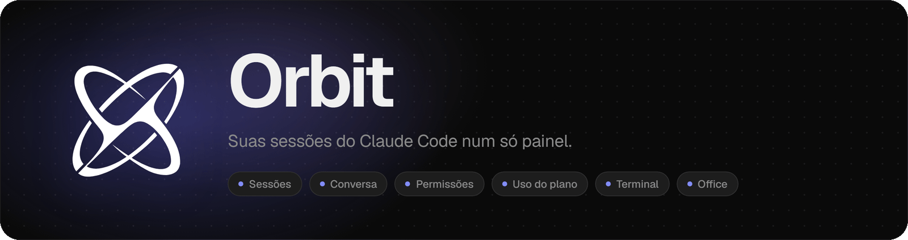
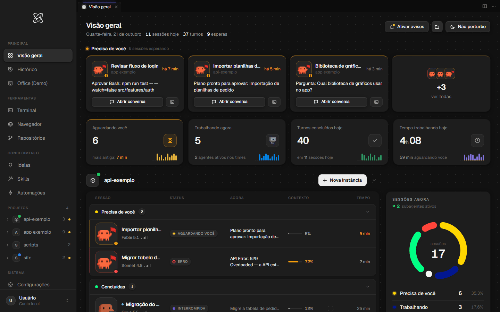
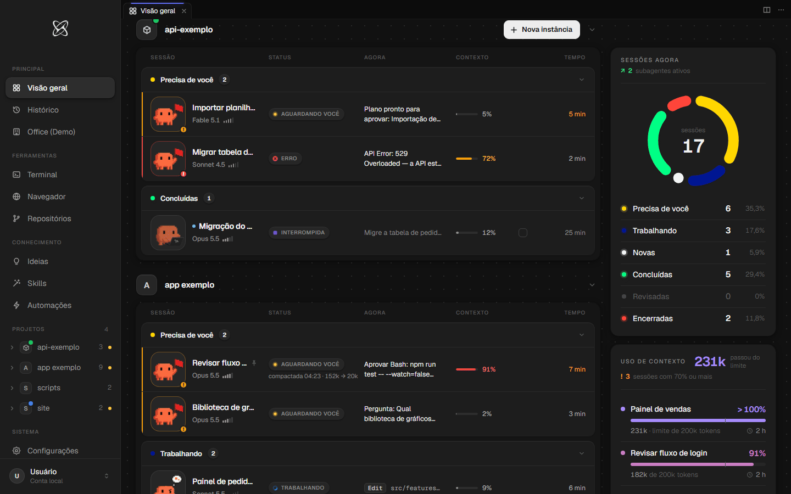
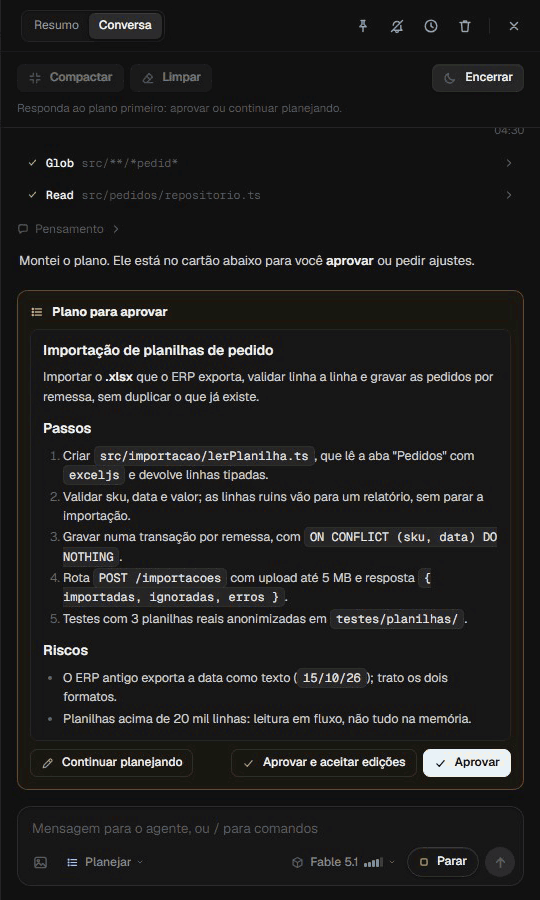
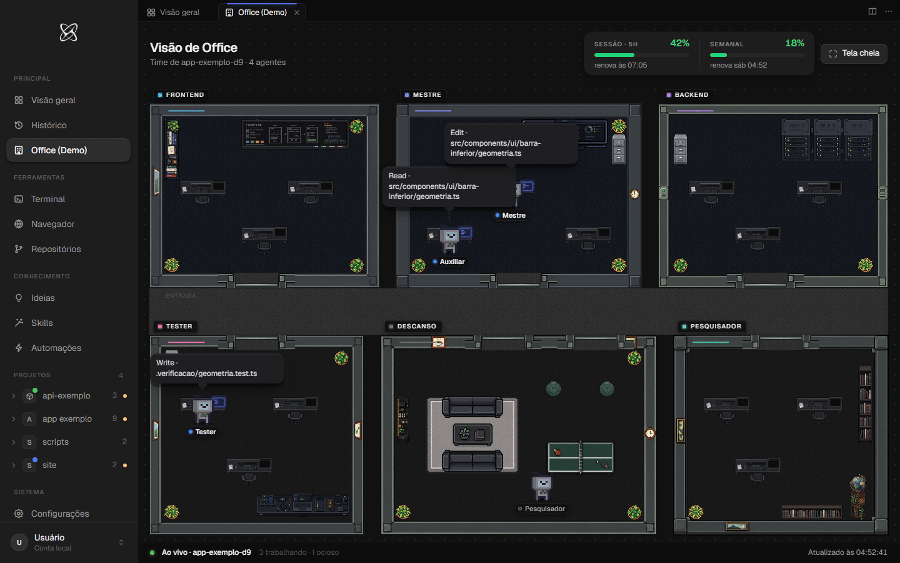
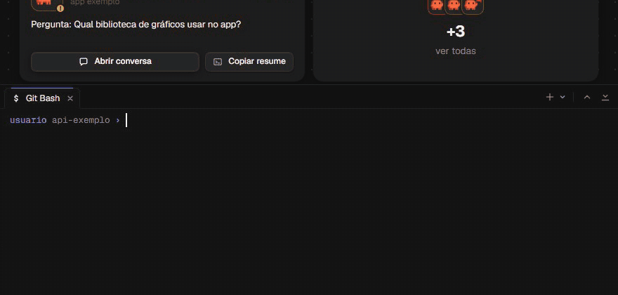

<div align="center">

<picture>
  <source media="(prefers-color-scheme: dark)" srcset=".github/assets/banner-escuro.png">
  <source media="(prefers-color-scheme: light)" srcset=".github/assets/banner-claro.png">
  
</picture>

<br>
<br>

&nbsp;
&nbsp;
&nbsp;


<br>
<br>

O **Orbit** é um painel local para acompanhar e controlar as suas sessões do Claude Code: lista das instâncias,<br>
conversa, permissões, uso do plano, terminal, arquivos, repositórios, música e, se você quiser, acesso pelo celular.

Tudo roda no seu computador, em `http://127.0.0.1:47821`. Nenhum dado sai da sua máquina, a não ser pelos<br>
serviços que você mesmo conectar (Claude, GitHub, Tailscale). **Só Windows** (10 ou 11).

[Por dentro](#por-dentro) · [Instalar](#instalar) · [Primeira vez](#primeira-vez) · [Dia a dia](#uso-do-dia-a-dia) · [Atualizar](#atualizar) · [Mais](#mais)

<br>



<sub>Capturas feitas numa instalação de teste, com dados de exemplo.</sub>

</div>

<br>

## Por dentro

### Sessões

Cada projeto com as suas sessões agrupadas (precisa de você, trabalhando, concluídas), o contexto usado e, ao lado, o
resumo das sessões agora e do uso de contexto.



### Conversa

<table>
  <tr>
    <td width="44%" valign="top">
      
    </td>
    <td valign="top">
      A conversa de qualquer sessão abre ao lado da lista, sem sair da Visão geral.
      <br><br>
      No exemplo, o agente monta um plano, você aprova com um clique e acompanha cada ferramenta rodando até a
      resposta final.
      <br><br>
      Pelo mesmo campo você manda mensagens, troca o modelo e o modo de permissão, compacta, limpa ou encerra a
      sessão.
    </td>
  </tr>
</table>

### Visão de Office

O time de agentes de um projeto num escritório: cada papel tem a sua sala, e o balão mostra o que o agente está
fazendo agora. Junto, o uso da sessão de 5 horas e o semanal.



### Terminal

Terminais de verdade dentro do Orbit, abertos na pasta do projeto. Continuam rodando ao trocar de tela ou recarregar
a página.



## Antes de instalar

| | O que | Observação |
|:-:|---|---|
| 1 | **Git para Windows** ([git-scm.com/download/win](https://git-scm.com/download/win)) | Para baixar e atualizar o Orbit. |
| 2 | **Node.js** ([nodejs.org](https://nodejs.org), a versão LTS) | O Orbit foi testado com o Node.js 24. |
| 3 | **Claude Code** e uma conta do Claude | Pela extensão do VS Code ou pela linha de comando. O Orbit usa o Claude Code que já está no seu computador; ele não baixa o Claude Code. |
| 4 | **Acesso ao repositório** (privado) | Peça o convite a quem te passou o Orbit. |

## Instalar

**1.** Abra um terminal (PowerShell ou Git Bash) na pasta onde você guarda os seus projetos.

**2.** Baixe o Orbit. Troque `<dono>` pelo endereço que veio no convite:

```powershell
git clone https://github.com/<dono>/orbit-public.git "Orbit Public"
```

**3.** Entre na pasta e instale as dependências. O `npm ci` instala as versões exatas:

```powershell
cd "Orbit Public"
npm ci
```

**4.** Dê dois cliques em `iniciar.cmd`. O servidor sobe e o Orbit abre no navegador, em `http://127.0.0.1:47821`.

## Primeira vez

Na primeira abertura, uma tela única pede:

- o seu nome e a pasta onde ficam os seus projetos;
- o login do Claude e, se quiser, o do GitHub;
- as permissões, **todas desmarcadas de saída**. Marque só o que quiser:
  - **hooks de monitoramento (recomendado):** sem eles, as sessões que você abre no terminal ou no VS Code não
    aparecem no Orbit; só aparecem as que você abrir pelo próprio Orbit. Eles entram no seu
    `~/.claude/settings.json`;
  - **abrir sozinho:** uma sessão do Claude Code liga o servidor do Orbit quando ele está fechado;
  - **aviso aos subagentes** e a **skill liderar-time**, para quem trabalha com times de subagentes;
- o celular, opcional e desligado de saída (cada um usa o próprio Tailscale).

> [!TIP]
> Para refazer: **Configurações → Servidor → "Assistente da primeira vez" → Refazer**.

## Uso do dia a dia

| Para | Faça |
|---|---|
| **Abrir** | `iniciar.cmd` (se o servidor já estiver no ar, só abre a página) |
| **Desligar** | `parar.cmd` |
| **Reiniciar** | Configurações → Servidor → Reiniciar |
| **Ligar junto com o Windows** (opcional) | `node logon.mjs instalar` (para tirar: `node logon.mjs remover`) |

## Atualizar

O Orbit nunca se atualiza sozinho. Quando houver versão nova:

**1.** Na pasta onde está o Orbit, baixe a versão nova e reinstale as dependências:

```powershell
cd "Orbit Public"
git pull
npm ci
```

**2.** Reinicie o servidor: Configurações → Servidor → Reiniciar, ou `parar.cmd` e `iniciar.cmd`.

## Mais

<details>
<summary><b>Onde ficam os seus dados</b></summary>

<br>

- **Na pasta do Orbit**, fora do git: configuração (`config.json`), estado, histórico, `logs/`, `notas/`,
  `progresso/` (arquivos de progresso dos subagentes) e `bin/` (a cópia do Claude Code que o Orbit usa). O
  `git pull` não mexe neles.
- **Em `%LOCALAPPDATA%\Orbit Public`:** o token do GitHub e as chaves de acesso das conexões MCP, cifrados pelo
  Windows (DPAPI).
- **No seu `~/.claude`:** só o que você marcou na primeira vez (hooks, status line, skill).

</details>

<details>
<summary><b>Desinstalar</b></summary>

<br>

**1.** Tire os hooks, a status line e a skill do Orbit do seu `~/.claude` (as suas configurações e skills ficam):

```powershell
node instalar.mjs --remover
```

**2.** Se você ligou o Orbit junto com o Windows:

```powershell
node logon.mjs remover
```

**3.** Rode `parar.cmd` e apague a pasta do Orbit e `%LOCALAPPDATA%\Orbit Public`.

</details>

<details>
<summary><b>Problemas comuns</b></summary>

<br>

- **As sessões do terminal ou do VS Code não aparecem:** os hooks de monitoramento estão desligados. Ligue pelo
  assistente (Refazer) e abra uma sessão nova do Claude Code.
- **A página não abre:** confira se a porta 47821 está livre e rode `iniciar.cmd` de novo. O registro do servidor
  fica em `logs/servidor.log`.
- **O terminal integrado não abre:** rode `npm ci` de novo na pasta do Orbit.

</details>

<details>
<summary><b>Para quem mantém esta cópia</b></summary>

<br>

As mudanças em relação ao Orbit original estão em `RECEITA.md`, e o envio ao repositório é feito com
`node ferramentas/enviar.mjs` (veja o comentário no começo do arquivo). As imagens deste README ficam em
`.github/assets/` e passam pela mesma varredura do envio, inclusive os metadados.

</details>
